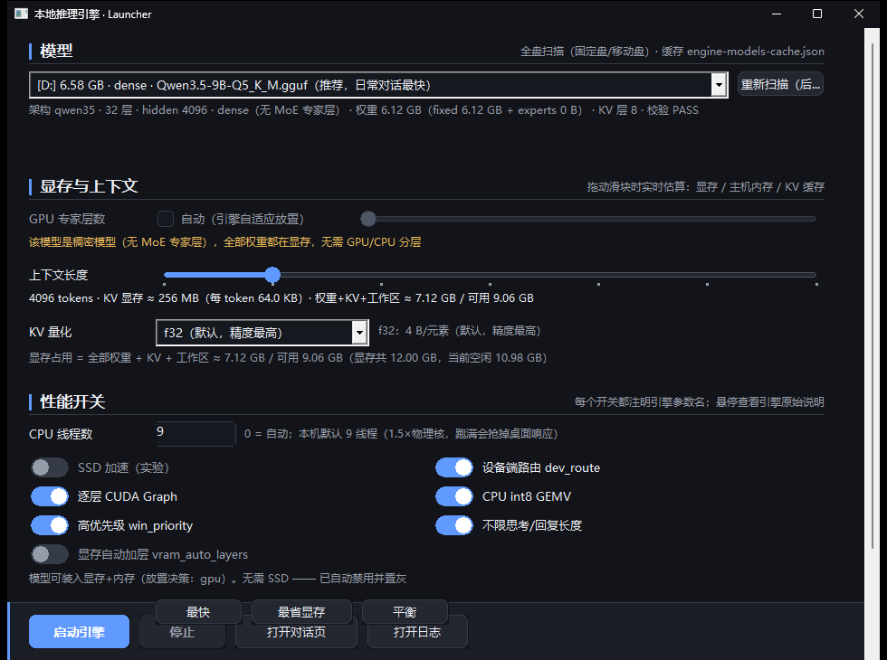
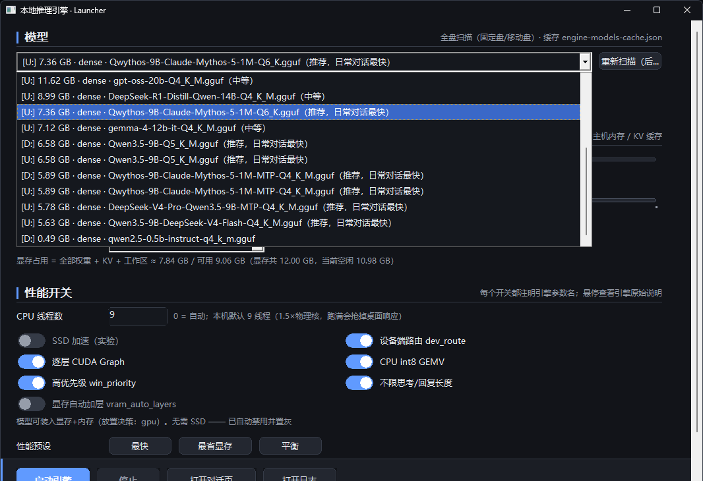
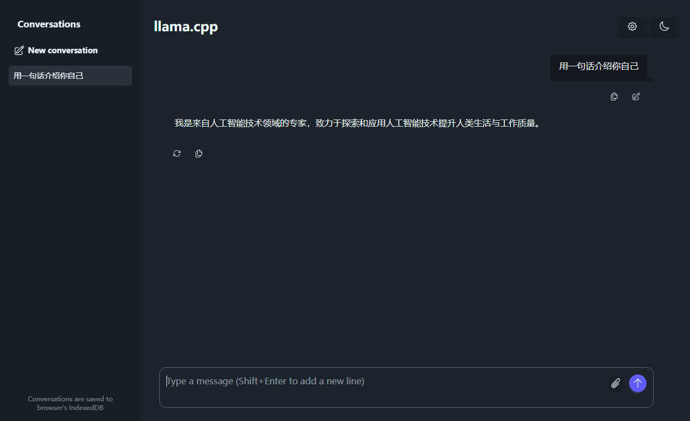

# local-llm-cuda — 自研 Windows 消费级 N 卡本地 LLM 推理引擎

[](LICENSE)
[](https://github.com/Siselea/local-llm-cuda/releases/latest)
[](https://github.com/Siselea/local-llm-cuda/actions/workflows/build.yml)

> **不想自己编译？** 直接下载 [Releases](https://github.com/Siselea/local-llm-cuda/releases) 里的
> `local-llm-cuda-v0.1.7-win64.zip`（Windows x64：engine.exe + launcher.exe + 启动脚本，不含模型）。
> 首次运行 web UI 前用 `bash tools/fetch_webui.sh` 获取聊天前端（MIT，4.4 MB，不随仓库分发）。

## 截图



*Win32 启动器：默认选中 9B（推荐），全盘模型扫描、GPU 专家层/上下文实时显存估算、放置决策回显；所有截图已裁掉底部日志路径区（无用户名/本机路径）。*



*模型下拉：`[D:]`/`[U:]` 盘符 + 大小 + 类型；全盘扫描结果带缓存，后台刷新不阻塞界面。*



*`engine serve` 直接服务的 llama.cpp 官方 web UI（MIT；首次用 `bash tools/fetch_webui.sh` 获取，未获取时使用内置极简页）。*


**面向 Windows + 消费级 NVIDIA 显卡**的自研 LLM 推理引擎（C++17 + CUDA）：
GGUF / safetensors 加载、MoE 专家 CPU 卸载与放置决策、逐层 CUDA Graph、KV 量化、
长上下文、OpenAI 兼容 HTTP 服务、以及一个 Win32 图形启动器（自动扫描全盘模型）。

> **本项目不包含任何模型权重。** 模型需自行下载并遵守其各自许可证；引擎只是一个运行时。

---

## 亮点（在一张 RTX 3060 12GB 上）

- **不依赖 MSVC / CUDA Toolkit / 管理员权限**：`ziglang` 提供 C++17 编译器，CUDA kernel 用
  **NVRTC** 运行时编译，cuBLAS/cudart 通过 pip 的 NVIDIA wheels 动态加载。
- **稠密 / MoE / MLA / hybrid SSM 全打通**：llama-like dense、DeepSeek-V2 MLA、Qwen3.5 / 3.6
  （hybrid Gated DeltaNet + MoE）四个真实模型与 llama.cpp / 官方 transformers 对拍逐 token 一致。
- **MoE 专家 CPU 卸载 + 自动放置决策器**：`auto` 档在装载前实测“显存 / 主机内存”，自动选择
  `gpu` / `vram+ram split` / `ssd`（SSD 流式为占位接口，未实现），按层粒度决定多少专家上 GPU。
- **逐层 CUDA Graph**、**int8 dp4a GEMV**、**fp16 tensor-core prefill GEMM**、**KV q8_0/q4_0 量化**、
  **ctx 自适应**、**MTP 投机解码（实验性，默认关闭）**。
- **HTTP 服务**：OpenAI 兼容 `/v1/chat/completions`、SSE 流式、llama.cpp `/completion`、
  `/tokenize`、`/props`、`/health`，并直接服务 llama.cpp 官方 web UI。
- **Win32 启动器**：图形界面、全盘扫描 `.gguf`（D:/E:/U: 等固定/移动盘，带缓存与后台刷新）、
  参数/显存估算、一键启动/停止/打开对话页。
- **无模型名硬编码**：模型扫描、量化/参数推断、放置决策都由文件内容与实测内存驱动。

---

## 性能实测（真实机器，非合成 benchmark）

测试条件：**RTX 3060 12 GB（GA104，解锁后 12GB）**，i5-10400F（6C/12T），32 GB DDR4，
Windows 11，`ctx=4096`、KV `f32`、greedy decode；llama.cpp 基线为同机同模型 `llama-server`
（b6000）同参数实测。decode 为稳定段 token/s。

| 模型 | 量化 | 大小 | decode | vs llama.cpp | 说明 |
|---|---|---:|---:|---:|---|
| DeepSeek-Coder-V2-Lite | Q5_K_M | 11.85 GB | **24.7 tok/s** | **136%** | MLA + MoE，24/26 MoE 层驻显存 |
| Huihui-Qwen3.6-35B-A3B | Q4_K_M | 21.84 GB | **26.9 tok/s** | **103.5%** | 40 层 MoE，18/40 层驻显存（自动放置） |
| Qwen3.5-9B | Q5_K_M | 6.58 GB | **45 tok/s** | **~96%** | hybrid SSM（Gated DeltaNet），全驻显存 |
| qwen2.5-0.5b | Q4_K_M | 0.49 GB | **195 tok/s** | — | 快速冒烟 / 服务验证用 |

补充实测：

- **prefill**：9B，1.6k token prompt → **1046–1097 tok/s**（同机 llama.cpp 的 ~79%；fp16 tensor-core GEMM）。
- **长上下文**：2048 token 填满后 decode 仅 **+5.4%** 延迟（KV 分块 + 量化路径）。
- **HTTP 端到端**（含 tokenize/采样/SSE 开销）：9B **44.69 tok/s**、35B **26.66 tok/s**。
- **CPU 专家卸载**：35B 在 12GB 卡上 Q4_K_M 只需 ~18 层专家驻显存即可跑，其余走 CPU AVX2 量化
  GEMV；CPU 专家路径做过 DRAM 带宽利用率验证（见 `docs/reports/CPU-OCCUPANCY-REPORT.md`）。
- **MTP 投机解码**：实验性；在本机 CPU 卸载场景下 net-negative，默认关闭（见 `MTP-IMPL-REPORT.md`）。

> 以上数字会随驱动、模型文件、量化与后台负载变化；复现方式见 `docs/reports/` 中对应报告。

---

## 特性

### 模型与量化

- **容器**：GGUF（单文件 / 分片 `-00001-of-000NN`，自动合并）、safetensors 目录（HF 配置）。
- **量化**：F32 / F16；Q4_0 / Q4_1 / Q5_0 / Q5_1 / Q8_0；K-quants Q2_K / Q3_K / Q4_K / Q5_K / Q6_K。
  - GPU decode GEMV 对 **Q4_K / Q5_K / Q6_K / Q8_0 / Q5_0 / Q5_1 / Q4_0** 有专门内核；
  - **IQ（i-quant）系列未支持**；遇到会给出明确错误而不是 silent fallback。
- **架构**：llama-like dense、MoE（融合/分片/shared 专家、专家 CPU/GPU 分置）、
  MLA（DeepSeek-V2）、hybrid SSM（Qwen3.5/3.6，Gated DeltaNet）、YaRN rope 扩展、
  MTP 头识别（`blk.N.nextn.*` 从常规层中剔除）。
- **KV 量化**：f32 / q8_0 / q4_0（含 MLA/SSM 状态路径），KV 估算与 ctx 自适应联动。

### 执行与放置

- **放置决策器**：`auto` 实测空闲显存/内存 → `gpu` / `vram+ram split` / `ssd`；
  支持显式 `--gpu-layers`、`--placement`、`--vram-margin`、`--host-margin`。
- **逐层 CUDA Graph**（`layer_graph_auto`）、设备端路由、int8 dp4a GEMV、fp16 prefill GEMM。
- **CPU 专家**：AVX2 量化 GEMV、多线程 expert 调度、CPU 占用实测与优先级处理。
- **MTP 投机解码**：实验性，`--mtp`/配置开关，默认关闭。

### 服务与界面

- **HTTP**：OpenAI 兼容 chat/completions、SSE、`/completion`（llama.cpp 兼容）、`/tokenize`、
  `/detokenize`、`/props`、`/v1/models`、`/slots`、`/health`、优雅 `/shutdown`；
  llama.cpp 官方 **web UI** 直接服务在 `/`（首次需 fetch，见下）。
- **Win32 launcher**：模型下拉（盘符/大小/类型/推荐/超大模型 ⚠ 提示）、GPU 专家层与 ctx 滑块实时
  显存估算、放置决策回显、全盘模型扫描（固定盘+移动盘、跳过系统目录、缓存秒开、后台刷新）、
  高级面板（引擎 schema 全量 100+ 配置项自动生成）、一键启动/停止/打开对话页。
- **101+ 配置项**：`--print-config --json` 输出全部键（cli/config/env/default 四层优先级），
  详见 [`docs/CONFIG.md`](docs/CONFIG.md)。

---

## 快速开始（Windows 11 x64）

### 1. 依赖

- Windows 11 x64 + **NVIDIA 显卡与驱动**（本项目在 RTX 3060 12GB 上开发/验收；
  其他 Ampere/Ada 消费卡理论可用）。
- Python 3.10+（仅构建/脚本需要）：

```bash
python -m pip install ziglang
python -m pip install nvidia-cuda-nvrtc-cu12 nvidia-cublas-cu12 nvidia-cuda-runtime-cu12
```

> 不需要 Visual Studio、不需要安装 CUDA Toolkit、不需要管理员权限。
> 若 Python 不在 PATH，构建时用 `PY=<python路径> bash build.sh` 指定。

### 2. 构建

```bash
bash build.sh
```

产物在 `build/`：`engine.exe`（命令行）、`launcher.exe`（图形启动器）、
`test_*.exe`（单元/集成测试）。构建脚本会打印每个产物。

### 3. 图形启动器（推荐普通用户）

```bash
build/launcher.exe        # 或双击仓库根目录的 启动.bat
```

- 首次启动会扫描**所有固定盘/移动盘**上的 `.gguf`（缓存位于 `build/engine-models-cache.json`，
  之后秒开；“重新扫描（后台）”按钮可强刷）。
- 在模型下拉里选模型 → 「启动引擎」→ 「打开对话页」。
- 首次使用 web UI 前，建议先 fetch 官方前端（4.4MB，MIT，不随仓库分发）：

```bash
bash tools/fetch_webui.sh     # 或 python tools/fetch_webui.py
```

  （不 fetch 也能用：服务会提供一个内置的极简聊天页。）
- 启动器会把日志写到 `build/launcher-engine.log`；停止/退出会清理子进程。

### 4. 命令行

```bash
# 列出全盘扫描到的模型（默认读缓存；--refresh 强制全盘重扫）
./build/engine.exe models
./build/engine.exe models --refresh --progress

# 启动 HTTP 服务（显式指定模型）
./build/engine.exe serve <MODEL_DIR>/Qwen3.5-9B-Q5_K_M.gguf --port 7030 --ctx 4096

# 自动选最大模型 / 选择扫描列表第 N 项
./build/engine.exe serve --model auto
./build/engine.exe serve --pick 1

# 交互式（终端里会询问 ctx / kv / 放置策略；CI/管道不会提示）
./build/engine.exe serve <MODEL_DIR>/model.gguf
```

浏览器打开 `http://127.0.0.1:7030/` 即为对话页。

常用参数：

```text
--host 127.0.0.1 --port 7030 --ctx 4096
--kv-type f32|q8_0|q4_0
--gpu-layers auto|-1|N       # MoE 专家层放显存的数量
--placement auto|gpu|split|ssd
--threads N                  # CPU 专家线程数；0=自动
--model-dir DIR              # 额外模型扫描目录（可重复/分号分隔）
--config <file>              # 配置文件（见 engine.cfg.example）
--print-config [--json]      # 打印生效配置 / schema
```

---

## 架构与模块

```text
engine.exe
├─ src/main.cpp          CLI 入口 / 子命令 / 交互式启动 / 放置决策编排
├─ src/ir.cpp            GGUF & safetensors → 统一 IR（张量、层、专家、注意力类型）
├─ src/planner.cpp       显存/内存预算与放置计划（专家层粒度）
├─ src/runner.cpp        执行器：KV cache、逐层调度、CUDA Graph、MTP、采样、流式输出
├─ src/cuda.cpp          CUDA runtime/context/stream/Graph 封装（NVRTC 编译 kernels.h）
├─ include/engine/kernels.h  NVRTC CUDA kernels（GEMV/GEMM/dequant/attention/MoE）
├─ src/cpu_matvec.cpp    CPU AVX2 量化 GEMV 与多线程 expert 前向（MoE CPU 卸载）
├─ src/qwen35.cpp        hybrid SSM（Qwen3.5/3.6）专用路径（GGUF vs HF 语义分路）
├─ src/mtp.cpp           MTP 投机解码（实验性）
├─ src/serve.cpp         OpenAI/llama.cpp 兼容 HTTP API + SSE + webui 静态服务
├─ src/http_server.cpp   极简 HTTP/1.1 server（keep-alive/chunked/CORS）
├─ src/launcher.cpp      Win32 GUI 启动器（全盘扫描、参数估算、后台刷新）
├─ src/model_scan.cpp    模型扫描/缓存/全盘枚举（固定+移动盘、跳过系统目录、多线程）
├─ src/config.cpp        101+ 配置项 schema（CLI/config/env/default）
└─ src/tokenizer.cpp     GGUF tokenizer（BPE/SPM、ChatML/Qwen 模板、Unicode 表）

pyref/                    Python 参考实现（IR/GGUF/safetensors 解析 + planner），
                          仅用于 diff_ir/diff_plan 对拍，不参与构建/运行
```

- 计算后端：**NVRTC** 运行时编译 `kernels.h` 中的 CUDA 源码；dense GEMM 走 **cuBLAS**；
  GPU 通过动态加载的 cudart/cuBLAS 运行，不要求 CUDA Toolkit 安装。
- CPU 侧：AVX2/FMA 量化 GEMV；MoE 专家层可整层放 CPU，按 token 路由。
- 放置决策器把“装载前实测的 free VRAM / free host RAM”与模型账本（fixed weights +
  expert bytes + KV + workspace）比较，决定 GPU/CPU 分层。
- 服务端与 web UI 的兼容细节见 [`docs/WEBUI.md`](docs/WEBUI.md)、[`docs/SERVE.md`](docs/SERVE.md)。

---

## 支持的模型与格式（如实）

- **GGUF**：F32/F16、Q4_0/Q4_1/Q5_0/Q5_1/Q8_0、Q2_K/Q3_K/Q4_K/Q5_K/Q6_K；
  分片 GGUF 自动合并；`mmproj-*` 视觉投影文件跳过。
- **safetensors**（HF 目录）：llama-like、DeepSeek-V2 MLA、Qwen3.5/3.6 hybrid SSM 等
  已验证架构；其它架构按“同构可加载”尝试并给出校验信息。
- **未支持**：IQ（i-quant）系列；非 NVIDIA GPU；Linux/macOS；多卡并行；
  SSD 专家流式（接口占位，`ssd_stream` 会明确报“未实现”）。
- 没有模型名特判：模型识别、量化/参数推断、放置决策都基于文件内容与实测内存。

---

## 已知限制

- **Windows only**（Win32 launcher + `CreateProcess`/NRTCC 路径）；仅 NVIDIA CUDA GPU；
  本机验证集中在 RTX 3060 12GB，其他显存容量的自适应逻辑理论成立但未大规模实测。
- **prefill 为 llama.cpp 的约 79%**（fp16 tensor-core GEMM）；35B 长 prompt 的 prefill 受
  CPU 专家层拖慢。
- **MTP 投机解码在本机 CPU 卸载场景净亏**（GPU 全驻留时才有收益），默认关闭。
- **1M 上下文不可行**：KV 显存账在 12GB 卡上不允许；实际支持到模型 ctx_train 与
  显存/内存预算内的长度（ctx 自适应给出上限）。
- **IQ 量化未支持**；部分冷门 GGUF 量化类型会拒绝加载并给出原因。
- 共享 GPU 的其他程序会改变 auto 放置结果；建议启动前确认显存空闲。
- 仅单用户/单 slot 服务设计（无连续 batching）；多用户并发不是目标场景。

---

## 测试与 CI

本地五套验证（在仓库根目录执行）（需要模型文件；先 `export MODEL_DIR=<你的模型目录>`，脚本内可 `PY=` 覆盖 Python）：

```bash
bash tools/verify.sh              # 主验证：单元测试 + IR/plan 对拍 + 生成一致性（ALL GREEN 为通过）
bash tools/smoke_models.sh        # 四个真实模型冒烟（需自备模型）
bash tools/gen_regression.sh      # 多 token 生成回归：与 llama.cpp greedy 逐 token 对拍
bash tools/verify_generality.sh   # 配置优先级/自适应放置/优雅失败/校准缓存
bash tools/verify_serve.sh        # HTTP 服务端到端（默认 0.5B@7031）：API/SSE/优雅退出
```

其它测试/验收脚本（HTTP、长上下文、分词器、35B e2e、webui 真实浏览器等）见
[`tools/README.md`](tools/README.md)；贡献流程与 PR 要求见 [`CONTRIBUTING.md`](CONTRIBUTING.md)。

> 本仓库发布的是**源码**：`build/`、模型权重、日志、测试产物都被 `.gitignore` 排除，
> 需要用户在本机构建与准备模型。

GitHub Actions（`.github/workflows/`）：

| workflow | 触发 | 做什么 |
|---|---|---|
| [build](https://github.com/Siselea/local-llm-cuda/actions/workflows/build.yml) | push / PR / 手动 | **windows-latest** 上 `pip install ziglang` + `bash build.sh`（无 CUDA 驱动只编译，不需要 GPU）；`sanity` 跑 shell/python 语法与 README 链接检查；`no-private-paths` 检查开发机绝对路径（盘符/用户目录）是否泄漏 |
| [release](https://github.com/Siselea/local-llm-cuda/actions/workflows/release.yml) | tag `v*` / 手动 | 构建 + 打 Windows zip + `SHA256SUMS.txt` + 上传 GitHub Release |

> 构建依赖：CI 不需要 GPU/CUDA Toolkit；`build.sh` 只是编译（NVRTC 源码是运行时编译）。
> 当前 CI 状态见顶部 **build** 徽章；截图见上。

---

## 文档索引

- [`docs/CONFIG.md`](docs/CONFIG.md) — 101+ 配置项手册（键 / CLI / 环境变量 / 默认 / 范围）
- [`docs/SERVE.md`](docs/SERVE.md) — HTTP 服务 API、SSE、llama.cpp 兼容细节
- [`docs/CPU-INT8.md`](docs/CPU-INT8.md) — CPU int8/AVX2 量化内核说明
- [`docs/WEBUI.md`](docs/WEBUI.md) — 聊天 UI 来源、离线属性、服务端兼容点
- [`docs/SERVE-STABILITY-FIXES.md`](docs/SERVE-STABILITY-FIXES.md) — 复读兜底 / think-budget / MTP serve 接线
- [`docs/RUST_FEASIBILITY.md`](docs/RUST_FEASIBILITY.md) — Rust 优化可行性评估（Q4_K 逐位对拍：Rust 慢 1.34–1.55×，无收益）
- [`docs/RUST-PROBE-REPORT.md`](docs/RUST-PROBE-REPORT.md) — Rust 工具链/内核探针的完整实测数据
- [`docs/BENCH-35B-VS-LLAMACPP.md`](docs/BENCH-35B-VS-LLAMACPP.md) — 35B 与 llama.cpp 的同条件 benchmark
- [`rust-probe/README.md`](rust-probe/README.md) — Rust 可行性原型（不参与 `build.sh`）
- [`docs/reports/INDEX.md`](docs/reports/INDEX.md) — **开发报告总索引**（性能/验证/根因分析）
- [`CONTRIBUTING.md`](CONTRIBUTING.md) — 构建/验证/代码风格/PR 要求
- [`docs/images/`](docs/images/) — README 截图（已裁掉私有路径）
- [`.github/workflows/`](.github/workflows) — GitHub Actions（build / release）
- [`pyref/README.md`](pyref/README.md) — Python 参考实现（仅对拍用，不参与构建）
- [`tools/README.md`](tools/README.md) — 所有验证/基准/诊断脚本
- [`engine.cfg.example`](engine.cfg.example) — 配置文件示例
- [`THIRD-PARTY.md`](THIRD-PARTY.md) — 第三方组件与模型许可证说明

重点报告（都在 `docs/reports/`）：

- `FINAL-REPORT.md` — v0 最终交付与门槛证据
- `PRE-FILL-REPORT.md` — prefill fp16 GEMM 优化
- `KV-LONGCTX-REPORT.md` — KV 量化与长上下文
- `SERVE-REPORT.md` — HTTP 服务收口（含思考漂移/多轮前缀缓存）
- `CPU-OCCUPANCY-REPORT.md` — decode 期间 CPU 占用实测
- `WEBUI-LAUNCHER-REPORT.md` — webui + Win32 launcher（全盘扫描/缓存/GUI 验收）
- `SPEC-COMPLIANCE.md` — 规格逐条符合性

---

## 许可与第三方

- 本项目代码：**MIT License**，见 [`LICENSE`](LICENSE)（Copyright (c) 2026 Siselea）。
- 聊天前端来自 **llama.cpp**（MIT，`ggml-org/llama.cpp` tag b6000），运行时不随仓库分发，
  由 `tools/fetch_webui.py` 下载。
- 运行时使用 **NVRTC / cuBLAS / cudart**（NVIDIA，用户自备）与 **ziglang**（MIT，构建工具）。
- **不包含任何模型权重**；Qwen / DeepSeek / Gemma 等模型遵循各自许可证，详见
  [`THIRD-PARTY.md`](THIRD-PARTY.md)。

---

## English (short)

**local-llm-cuda** is a from-scratch LLM inference engine for **Windows + consumer NVIDIA
GPUs** (C++17 + CUDA, no MSVC/CUDA Toolkit/admin required: ziglang + NVRTC + pip CUDA wheels).

- GGUF & safetensors loading; MoE expert CPU offload with an auto placement decider;
  per-layer CUDA Graphs; int8 dp4a GEMV; fp16 tensor-core prefill GEMM; KV q8_0/q4_0;
  long-context; experimental MTP; OpenAI-compatible HTTP server with SSE and the official
  llama.cpp web UI; Win32 GUI launcher that scans all fixed/removable drives for models.
- On one RTX 3060 12GB: Coder-V2-Lite Q5_K_M 24.7 tok/s (**136%** of llama.cpp),
  Qwen3.6-35B-A3B Q4_K_M 26.9 tok/s (**103.5%**), Qwen3.5-9B Q5_K_M 45 tok/s (~96%),
  0.5B Q4_K_M 195 tok/s; 9B prefill 1.6k prompt ~1046–1097 tok/s (~79% of llama.cpp).
- **No model weights are included.** Bring your own GGUF and comply with its license.
- Quick start: `python -m pip install ziglang nvidia-cuda-nvrtc-cu12 nvidia-cublas-cu12
  nvidia-cuda-runtime-cu12` → `bash build.sh` → `build/launcher.exe` (or
  `./build/engine.exe serve <MODEL_DIR>/model.gguf --port 7030 --ctx 4096`),
  then open `http://127.0.0.1:7030/`. Chat UI: `bash tools/fetch_webui.sh`.
- MIT licensed code; third-party notices in [`THIRD-PARTY.md`](THIRD-PARTY.md).
- Docs: [`docs/CONFIG.md`](docs/CONFIG.md), [`docs/SERVE.md`](docs/SERVE.md),
  [`docs/reports/INDEX.md`](docs/reports/INDEX.md).
